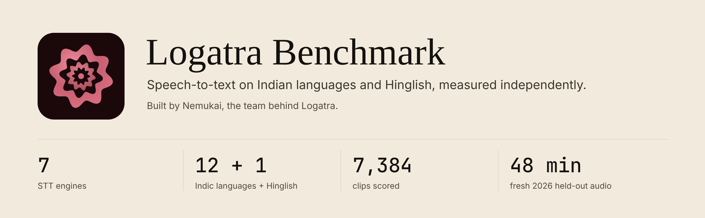

# Logatra Benchmark



**Leaderboard:** [nemukai.com/labs/logatra-benchmark](https://nemukai.com/labs/logatra-benchmark) ·
**Dataset:** [huggingface.co/datasets/CooledNik/logatra-benchmark](https://huggingface.co/datasets/CooledNik/logatra-benchmark) ·
**Space:** [huggingface.co/spaces/CooledNik/logatra-benchmark](https://huggingface.co/spaces/CooledNik/logatra-benchmark)

An independent benchmark for speech-to-text on Indian languages and Hinglish,
built to answer one practical question honestly: **which STT engine should you
actually run for Indian speech, at what accuracy, and at what price?**

Seven systems, scored on ~1,000 minutes of public Indic test audio and a
fresh 2026 held-out split that is far less exposed to training than any
public test set (but see the caveat on saaras v4 below):

| System | Model | Coverage |
|---|---|---|
| `sarvam-saaras-v4` | Sarvam saaras:v4 | full public split + held-out |
| `sarvam-saaras` | Sarvam saaras:v3 | full public split + held-out |
| `sarvam` | Sarvam saarika:v2.5 | full public split + held-out |
| `whisper` | OpenAI whisper-1 | full public split + held-out |
| `gemini` | Gemini 3.5 Flash (via OpenRouter) | 800-sample public subset + held-out |
| `voxtral` | Mistral Voxtral Small 24B (via OpenRouter) | 800-sample public subset + held-out |
| `gpt-audio` | OpenAI gpt-audio (via OpenRouter) | 336-sample public subset + held-out |

Because coverage is uneven, the headline table is computed on the
**comparable intersection**: only samples every system completed
(324 public, 132 held-out). Full-split numbers are reported alongside.
Adapters for Deepgram, ElevenLabs, Google, and AssemblyAI exist but have not
been run yet (see Roadmap).

## Results (comparable intersection)

Strict WER, word-weighted, with 95% bootstrap CIs (public: resampling clips;
held-out: resampling the 11 source videos, so held-out intervals are wide).
`sa` = script-agnostic WER (fair to code-mix script choice); `med` = median
per-sample WER (robust to repetition loops).

| System | public WER [95% CI] | public sa | held-out WER [95% CI] | held-out sa | held-out med | $/audio-hour |
|---|---|---|---|---|---|---|
| sarvam-saaras-v4 | 0.261 [0.237, 0.286] | 0.238 | 0.258 [0.150, 0.377] | 0.238 | 0.134 | ~0.35 |
| gemini | 0.265 [0.243, 0.288] | 0.246 | 0.222 * [0.136, 0.310] | 0.205 * | 0.117 * | ~0.43 |
| sarvam-saaras | 0.323 [0.293, 0.353] | 0.293 | 0.228 [0.121, 0.348] | 0.210 | 0.106 | ~0.35 |
| sarvam | 0.373 [0.340, 0.407] | 0.331 | 0.197 * [0.087, 0.319] | 0.181 * | 0.000 * | ~0.35 |
| gpt-audio | 0.535 [0.482, 0.599] | 0.512 | 0.285 [0.197, 0.394] | 0.270 | 0.198 | ~1.39 |
| whisper | 0.783 [0.746, 0.825] | 0.706 | 0.476 * [0.398, 0.580] | 0.458 * | 0.390 * | 0.36 |
| voxtral | 2.938 [1.471, 4.946] | 2.901 | 0.720 [0.316, 1.525] | 0.702 | 0.266 | ~0.36 |

`*` = this system contributed to the held-out references (see below). Its
held-out score is an upper bound, not a clean measurement, so the page does
not rank it on held-out: contributors are listed unranked with their
`self_ref_rate` (sarvam 58%, gemini 38%, whisper 5% of held-out rows use that
system's own output as the reference) and their score on the remaining rows
(`by_provider_comparable_nonself` in `report/data.json`; e.g. saarika's
held-out sa WER is 0.408 on the 56 rows it did not write, against 0.181
overall).

Absolute held-out CIs are wide because the 132 chunks come from only 11
videos. Paired gaps on the same clips are much tighter (all in
`report/data.json` under `pairwise_comparable` and `gaps_vs_top`).

Findings worth calling out:

- **On the public split, saaras v4 and Gemini are statistically tied**
  (strict WER 0.261 vs 0.265; gap +0.3 pts for Gemini, 95% CI
  [-1.5, +2.0]). Saaras v4 is the fastest of the seven (0.6 s median per
  clip) and clearly ahead of saaras v3 (gap -6.2 pts, CI [-8.5, -3.9]).
- **On fresh held-out audio, saaras v3 edges v4**: script-agnostic WER 21.0%
  vs 23.8%, a gap of +2.8 pts for v4 with paired cluster-bootstrap CI
  [+1.2, +4.4]. Neither wrote the held-out references, so this is a clean
  measurement, though small. Among non-contributors, gpt-audio cannot be
  separated from either Sarvam model (gap to v3 +6.0 pts, CI [-2.5, +13.9]).
- **Voxtral falls into repetition loops** on Indic audio (46 of 896 outputs
  are runaway repetitions), which is why its mean WER exceeds 100% while its
  median is far lower. The explorer shows the raw cases.
- **Whisper collapses on conversational Hindi**: usable on read speech
  (FLEURS), close to unusable on real interview audio in the held-out split.

## Two-layer design

Public Indic test sets (FLEURS, Gramvaani, MUCS) are widely used to train the
very models being evaluated, so scores on them are contamination-prone and
flattering. The benchmark therefore has two layers:

- `split: public` (7,253 samples): FLEURS test for 12 Indic languages
  (as, bn, gu, hi, kn, ml, mr, or, pa, ta, te, ur), Gramvaani Hindi telephony,
  and MUCS 2021 Hindi-English code-mixed speech. A comparable baseline against
  published numbers, treated as a **contaminated baseline**, never the
  headline.
- `split: heldout` (132 samples, ~48 minutes): Hindi/Hinglish conversational
  audio chunked from 11 Creative Commons (CC-BY) YouTube videos uploaded
  January to June 2026. That is after the release of most tested models,
  but not all: Sarvam saaras v4 was released in September 2026, after this
  audio was public, and no vendor's training data can be verified, so the
  split is "much less likely to have been trained on", not "unseen". Interviews,
  podcasts, and lecture-style speech, heavy on real code-mixing. Currently
  **Hindi only**; see [ATTRIBUTION.md](ATTRIBUTION.md) for the sources.

### How held-out references were made (read this before citing them)

There is no human gold transcription yet. References are **silver**:

1. Three systems (saarika, gemini, whisper) transcribed every chunk; the
   medoid hypothesis under a consensus distance (min of symmetric WER and
   romanized CER, so script choice does not count as disagreement) became the
   candidate reference. 96/132 rows cleared the automatic agreement threshold.
2. The remaining 36 rows were adjudicated one by one: accept when at least
   two systems agree on content, choose the medoid verbatim, override only
   for demonstrable mishears (checkable against domain facts, the video's own
   metadata, or third-system corroboration). Every decision and rationale is
   logged in
   [heldout_yt.adjudications.json](data/manifests/heldout_yt.adjudications.json).
   Adjudication was performed by an LLM from the hypothesis texts, not from
   audio.

Consequences, stated plainly: held-out scores for contributor systems are
upper bounds (a system cannot disagree with its own reference), the
`self_ref_rate` column quantifies the exposure per system, and the cleanest
held-out comparison is between non-contributors (sarvam-saaras-v4, sarvam-saaras, gpt-audio,
voxtral). Independent human transcription of the held-out audio is the top
roadmap item and would upgrade silver to gold.

## Metrics

- **Strict WER/CER** on Indic-aware normalized text: NFC, lowercase,
  Indic digit mapping, Indic punctuation stripping (danda, Urdu marks).
- **Script-agnostic WER**: every Indic-script run (Devanagari,
  Bengali/Assamese, Gurmukhi, Gujarati, Odia, Tamil, Telugu, Kannada,
  Malayalam) is transliterated to Latin (IAST, diacritics stripped, schwa
  deletion) before comparison, so "स्टार्ट" vs "start", or Odia speech
  written in Devanagari, is not an error. Urdu (Perso-Arabic) omits short
  vowels, so whenever Urdu script is on either side both sides are reduced
  to a shared consonant skeleton instead (more lenient; rationale in
  `logatra_benchmark/metrics.py:consonant_skeleton`). The Devanagari path is
  unchanged from v1. Reported as a separate column, never silently replacing
  strict WER.
- **Aggregation**: all WER figures (tables, leaderboard, language matrix)
  are word-weighted: sum of per-sample errors over sum of reference words.
  Page "accuracy" is max(0, 1 − word-weighted script-agnostic WER).
- **Uncertainty**: 95% percentile bootstrap CIs (B=2000, fixed seed) on every
  comparable-set score, every language cell and every pairwise gap. The
  held-out split resamples whole source videos (chunks of one video are
  correlated); the public split resamples samples. A gap whose CI includes 0
  is reported as a tie, and the page shares ranks accordingly.
- **Median per-sample WER**: robustness view; loops and hallucinations move
  the mean, not the median.
- **Latency, RTF, cost**: per-call latency from the runner, real-time factor,
  and cost from provider-reported usage or published per-minute rates.

## Reproducing

Requires Python 3.12+ and [uv](https://docs.astral.sh/uv/). Raw provider
responses are cached as JSON under `results/<system>/<sample_id>.json`, so
scoring and the full report rebuild **offline, without any API key**:

```bash
uv sync --extra dev                       # dev extra installs pytest
# audio + results cache from the HF dataset (public, no token):
uv run --with huggingface_hub python -c "from huggingface_hub import snapshot_download; \
  snapshot_download('CooledNik/logatra-benchmark', repo_type='dataset', \
  local_dir='data/local/hf_snapshot', allow_patterns=['audio/*','results/*'])"
mv data/local/hf_snapshot/results results
mv data/local/hf_snapshot/audio data/audio
uv run python scripts/score_report.py --out report/data.json \
    --carry-forward report/rows.json \
    data/manifests/full_public.jsonl data/manifests/heldout_yt.silver.jsonl
uv run python scripts/export_explorer.py
uv run python scripts/build_report.py     # writes report/index.html
uv run pytest                             # metrics, scoring, silver tests
```

`--carry-forward` keeps the previously published Gramvaani rows (metrics
only): the Gramvaani provider outputs are not redistributed, so they cannot
be rescored from the public cache (see below).

Private split: manifests may use `split: "private"` for fresh audio that is
never published. Scoring, the explorer and the page build drop private rows
by default; `--include-private` on `score_report.py` / `export_explorer.py`
writes only to `data/private/reports/` (gitignored), and
`scripts/publish_hf.py` refuses to stage anything under `data/private/`.

To run systems fresh (needs keys, spends money):

```bash
uv run python -m logatra_benchmark run \
    --manifest data/manifests/m1_public.jsonl \
    --providers sarvam-saaras,whisper --workers 8
```

Sarvam's real-time endpoint rejects clips longer than 30 s (HTTP 400), so
17 public clips (11 FLEURS, 4 MUCS, 2 Gramvaani) are absent for every Sarvam
entrant; the comparable-intersection tables are unaffected. The Batch API
would close that gap and is on the roadmap.

Keys via env: `SARVAM_API_KEY`, `OPENAI_API_KEY`, `OPENROUTER_API_KEY`
(gemini/voxtral/gpt-audio), plus `DEEPGRAM_API_KEY`, `ELEVENLABS_API_KEY`,
`ASSEMBLYAI_API_KEY`, `GOOGLE_APPLICATION_CREDENTIALS` for the unrun adapters.

Gramvaani is the exception: its license is academic-use-only with no
redistribution grant, so the committed manifests carry Gramvaani rows with an
empty `reference_text`, and neither the references nor the provider outputs
are in the HF dataset. The report keeps the Gramvaani rows scored in the
original run via `--carry-forward`. To rescore Gramvaani from scratch you need
both the references (download OpenSLR 118 yourself) and your own provider
outputs for those clips (a paid `run` over the Gramvaani manifest); then:

```bash
uv run python scripts/prepare_gramvaani.py       # downloads GV_Dev_5h + GV_Eval_3h
uv run python scripts/merge_gramvaani_refs.py    # fills reference_text by sample id
```

The audio (about 1.1 GB after excluding Gramvaani) and the raw results cache
are distributed as a [Hugging Face dataset](https://huggingface.co/datasets/CooledNik/logatra-benchmark) (see "Data and licensing" below);
the repo carries manifests, code, and the generated report.

## Layout

```
logatra_benchmark/    harness: manifest, metrics, runner, silver consensus, adapters/
data/manifests/       JSONL manifests (public + held-out), adjudication log
scripts/              dataset prep, collection, scoring, report build, HF publish
report/               generated leaderboard + per-case diff explorer (static HTML)
tests/                pure-python tests: normalization, script-agnostic WER, scoring/bootstrap, silver
```

## Disclosure

This benchmark is built by [Nemukai](https://nemukai.com). Our product [Logatra](https://logatra.com)
runs Sarvam saaras:v4 in production (since 25 October 2026, even though v3 leads on
the held-out split here); the benchmark exists because we needed to
choose a provider and did not trust vendor-reported numbers. That is a
conflict of interest you should know about. Mitigations: every raw provider
response is cached and shipped, scoring is reproducible offline, the
methodology penalizes nobody by hand, and the reference pipeline's bias
exposure is quantified per system (`self_ref_rate`).

## Roadmap

- Independent human transcription of the held-out split (silver to gold).
- Complete the public split for gemini, voxtral, gpt-audio.
- Route the 17 over-30 s clips through Sarvam's Batch API.
- Run the written-but-unrun adapters: Deepgram, ElevenLabs Scribe, Google,
  AssemblyAI.
- Multi-language held-out audio beyond Hindi.
- Speaker diarization (DER): metric implemented, no diarization runs yet.

## Data and licensing

Code is MIT ([LICENSE](LICENSE)). The audio and transcripts come from four
sources with four different licenses, and only the ones that permit
redistribution are shipped:

| Subset | Source | License | Shipped in the dataset |
|---|---|---|---|
| `fleurs` (1,200 clips, 12 languages) | [google/fleurs](https://huggingface.co/datasets/google/fleurs), test split | CC-BY-4.0 | yes: audio, references, provider outputs |
| `mucs2021` (3,136 clips, Hindi-English) | [OpenSLR 104](https://www.openslr.org/104/), subtask 2 test | CC-BY-SA-4.0 | yes: audio, references, provider outputs (ShareAlike applies to the derived outputs) |
| `heldout_yt` (132 chunks, ~48 min) | 11 YouTube videos, CC-BY as set by each uploader | CC-BY-3.0 | yes: the 16 kHz chunks only, never full videos; per-video credit in [ATTRIBUTION.md](ATTRIBUTION.md) |
| `gramvaani` (2,917 clips, Hindi telephony) | [OpenSLR 118](https://www.openslr.org/118/), Dev 5h + Eval 3h | academic use only; commercial use by permission of contact@gramvaani.org; no redistribution grant | **no**: neither audio, references, nor provider outputs. Scores are reported; reproduce them locally via `scripts/prepare_gramvaani.py` |

Provider outputs (the results cache) are our own API calls, but they are
transcriptions of the source audio, so they inherit the source license and
are excluded wherever the source is. Raw archives under `data/raw/` are never
redistributed.

If you are a rights holder for any of the held-out videos and want your
material removed, open an issue and it will be pulled promptly.
