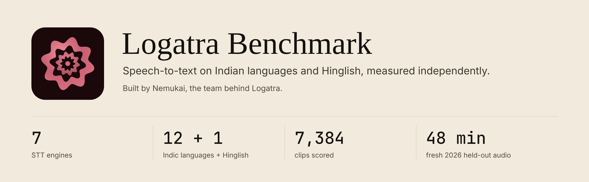
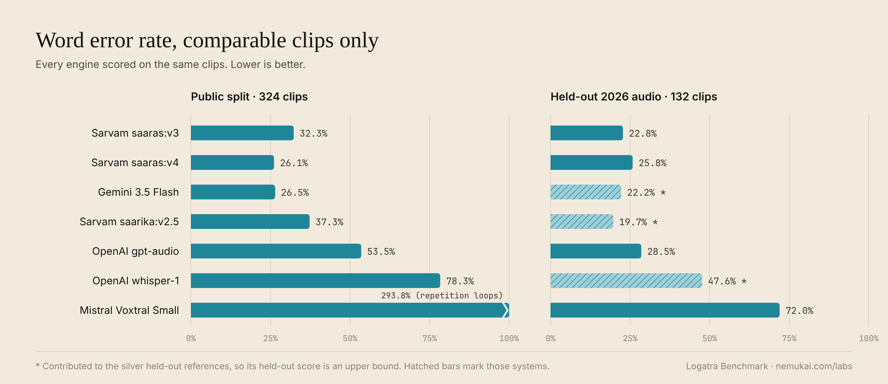
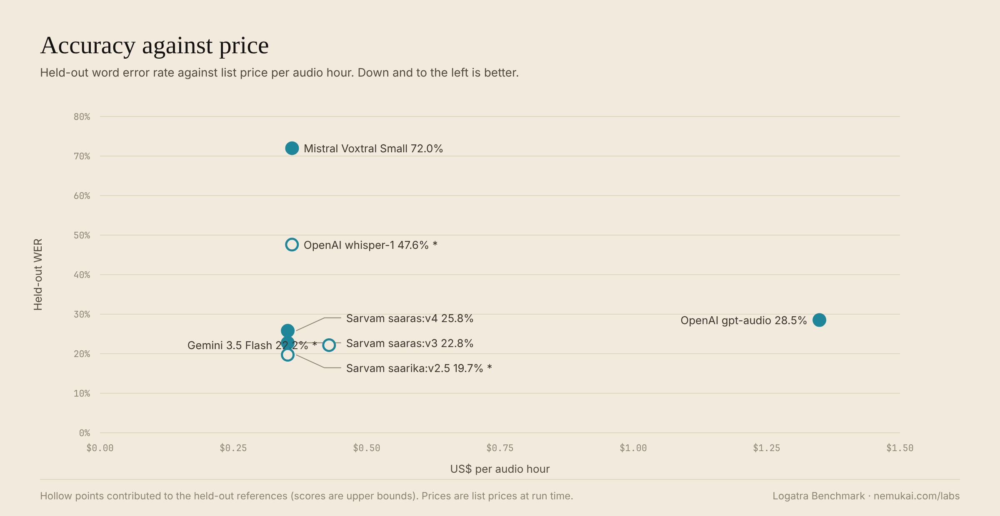
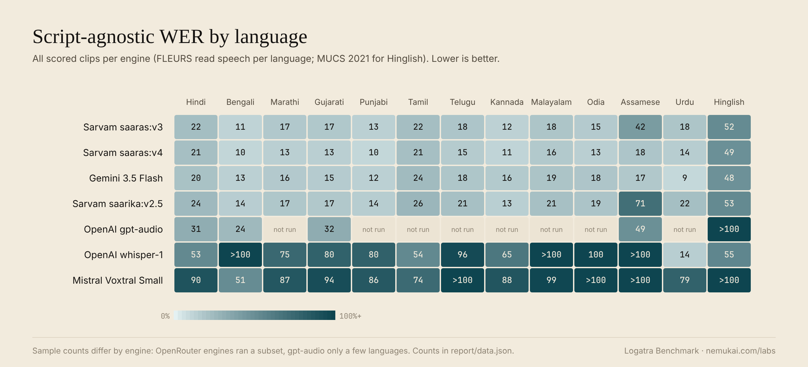

---
license:
  - cc-by-4.0
  - cc-by-sa-4.0
  - cc-by-3.0
language:
  - hi
  - bn
  - ta
  - te
  - mr
  - gu
  - kn
  - ml
  - pa
  - or
  - as
  - ur
  - en
task_categories:
  - automatic-speech-recognition
tags:
  - indic
  - hinglish
  - code-switching
  - benchmark
  - speech-to-text
  - evaluation
  - logatra
pretty_name: Logatra Benchmark
size_categories:
  - 1K<n<10K
thumbnail: https://raw.githubusercontent.com/Nemukai/logatra-benchmark/main/hf/assets/logatra-logo.png
configs:
  - config_name: heldout
    data_files: manifests/heldout_yt.silver.jsonl
  - config_name: fleurs
    data_files: manifests/fleurs_*.jsonl
  - config_name: mucs2021
    data_files: manifests/mucs2021_hi_en.jsonl
---



# Logatra Benchmark

An independent speech-to-text benchmark for Indian languages and Hinglish, built by
[Nemukai](https://nemukai.com), the team behind [Logatra](https://logatra.com).
Seven commercial STT engines are scored on a public split and on a fresh held-out
split of 2026 Creative Commons audio, published January to June 2026. That
postdates the release of most engines tested, but not saaras v4 (September 2026),
and no vendor's training data can be verified, so treat it as far less exposed than
public test sets rather than guaranteed unseen.

This repository holds the audio, manifests and every raw provider response, so the
whole leaderboard can be re-scored offline without an API key.

| | |
|---|---|
| Leaderboard and per-case explorer | [nemukai.com/labs/logatra-benchmark](https://nemukai.com/labs/logatra-benchmark) |
| Same report as a Space | [CooledNik/logatra-benchmark](https://huggingface.co/spaces/CooledNik/logatra-benchmark) |
| Code, harness and methodology (MIT) | [github.com/Nemukai/logatra-benchmark](https://github.com/Nemukai/logatra-benchmark) |
| Logatra, the transcription product | [logatra.com](https://logatra.com) |

## Results

Every engine on the same clips: 324 from the public split and all 132 held-out
chunks. Lower is better.



| Engine | Public WER [95% CI] | Held-out WER [95% CI] | Held-out median | US$ per audio hour |
|---|---|---|---|---|
| Sarvam saaras:v3 | 32.3% [29.3, 35.3] | 22.8% [12.1, 34.8] | 10.6% | ~0.35 |
| Sarvam saaras:v4 | 26.1% [23.7, 28.6] | 25.8% [15.0, 37.7] | 13.4% | ~0.35 |
| Gemini 3.5 Flash | 26.5% [24.3, 28.8] | 22.2% \* | 11.7% \* | ~0.43 |
| Sarvam saarika:v2.5 | 37.3% [34.0, 40.7] | 19.7% \* | 0.0% \* | ~0.35 |
| OpenAI gpt-audio | 53.5% [48.2, 59.9] | 28.5% [19.7, 39.4] | 19.8% | ~1.39 |
| OpenAI whisper-1 | 78.3% [74.6, 82.5] | 47.6% \* | 39.0% \* | 0.36 |
| Mistral Voxtral Small 24B | 293.8% [147, 495] | 72.0% [31.6, 152.5] | 26.6% | ~0.36 |

Word-weighted WER; 95% bootstrap confidence intervals resample clips on the public
split and whole source videos on the held-out split (11 videos, hence the wide
held-out intervals; paired gaps between engines are much tighter).

\* Contributed to the silver held-out references, so its held-out score is an upper
bound and it is not ranked on held-out (see below).

What stands out:

- **Saaras v4 and Gemini are statistically tied on the public split** (26.1% vs
  26.5%; 95% CI on the gap -1.5 to +2.0 points). Saaras v4 is the fastest of the
  seven (0.6 s median per clip).
- **On fresh held-out audio saaras v3 edges v4** by 2.8 points of script-agnostic
  WER (paired CI +1.2 to +4.4, resampling videos). Neither wrote the held-out
  references, so that gap is a clean, if small, measurement.
- **Voxtral falls into repetition loops** on Indic audio: 46 of 896 outputs are
  runaway repetitions, which is why its mean WER is above 100% while its median is
  far lower.
- **Whisper collapses on conversational Hindi**: usable on read speech, close to
  unusable on real interview audio.





## What is here

| Path | Contents |
|---|---|
| `manifests/*.jsonl` | one JSON object per sample: `id`, relative `audio_path`, `reference_text`, `language`, `code_mixed`, `source`, `license`, `split` |
| `audio/fleurs/` | 1,200 FLEURS test clips, 12 Indic languages, 16 kHz mono WAV |
| `audio/mucs2021/` | 3,136 MUCS 2021 Hindi-English code-switched clips, 16 kHz mono WAV |
| `audio/heldout_yt/` | 132 chunks (about 48 minutes) cut from 11 CC-BY YouTube videos published January to June 2026 |
| `results/<system>/<sample_id>.json` | the raw cached response of every provider call: text, latency and the provider's own payload |
| `report/data.json`, `report/rows.json` | aggregated and per-sample metrics (WER, CER, script-agnostic WER, latency, cost) |
| `manifests/heldout_yt.adjudications.json` | every adjudication decision for the 36 held-out rows that failed the automatic consensus gate |
| `assets/` | the figures on this page and the Logatra logo |

The dataset viewer shows three configs: `heldout` (silver references), `fleurs`
and `mucs2021`. Audio paths in the manifests are relative to the `manifests/`
folder.

```python
from huggingface_hub import snapshot_download

path = snapshot_download("CooledNik/logatra-benchmark", repo_type="dataset")
# then score offline with the harness from github.com/Nemukai/logatra-benchmark
```

## How the held-out split was made

Eleven Hindi and Hinglish YouTube videos published between January and June 2026
(before saaras v4's September 2026 release, so not guaranteed unseen by it),
each released by its uploader under the Creative Commons Attribution license, were
cut into 132 chunks of about 22 seconds. They are long-form interviews, podcasts and
talks: conversational speech with code-mixing, the kind of audio
[Logatra](https://logatra.com) customers upload. Only the chunks are shipped, never
the full videos.

### References are silver, not gold

There is no human gold transcription of the held-out split yet. Each reference is
the medoid of three systems' hypotheses under a script-agnostic consensus distance,
and the 36 rows that failed the automatic gate were adjudicated case by case. The
systems that contributed hypotheses (saarika, Gemini, Whisper) score against
references they partly wrote, so their held-out scores are upper bounds;
`self_ref_rate` in `report/data.json` gives the exposure per system (saarika 58%,
Gemini 38%, Whisper 5%). Read the methodology in the
[GitHub README](https://github.com/Nemukai/logatra-benchmark) before citing held-out
numbers.

## What is deliberately not here

The Gramvaani Hindi telephony subset (OpenSLR 118, 2,917 clips) is licensed for
academic use only, with commercial use by permission and no redistribution grant.
Its audio, transcripts and the provider outputs derived from it are excluded. The
manifests keep the Gramvaani rows with an empty `reference_text` so sample ids stay
stable; the GitHub repository documents how to download OpenSLR 118 yourself and
merge the references back in.

Nothing in this dataset comes from Logatra customers or private recordings.

## Licensing

Each subset keeps the license of its source, and every manifest row carries its own
`license` field.

| Subset | Source | License |
|---|---|---|
| `fleurs` | [google/fleurs](https://huggingface.co/datasets/google/fleurs), test split (Conneau et al., 2022) | CC-BY-4.0 |
| `mucs2021` | [OpenSLR 104](https://www.openslr.org/104/), MUCS 2021 subtask 2 (Diwan et al., 2021) | CC-BY-SA-4.0 |
| `heldout_yt` | 11 YouTube videos whose uploaders chose the Creative Commons Attribution license; per-video credit in `ATTRIBUTION.md` | CC-BY-3.0 |
| `results/`, `report/` | Nemukai's own API calls and measurements, derived from the audio above | same license as the underlying subset; the MUCS-derived outputs are CC-BY-SA-4.0 |

If you hold the rights to any of the held-out videos and want your material removed,
open an issue on the [GitHub repository](https://github.com/Nemukai/logatra-benchmark)
and it will be pulled promptly.

## Disclosure

[Logatra](https://logatra.com) is Nemukai's transcription product, so we have a
stake in these numbers. The benchmark exists because we needed to choose a provider
and did not trust vendor-reported results. Logatra runs Sarvam saaras:v4 in
production since 25 October 2026 (saaras v3 before that), even though v3 leads on the held-out split
here. Every raw provider response is shipped so the scoring can be checked.

## Citation

```bibtex
@misc{logatra-benchmark-2026,
  title  = {Logatra Benchmark: speech-to-text on Indian languages and Hinglish},
  author = {Singh, Priyansh Kumar},
  year   = {2026},
  publisher = {Nemukai},
  url    = {https://huggingface.co/datasets/CooledNik/logatra-benchmark}
}
```

Please also cite the source datasets: FLEURS (Conneau et al., 2022) and MUCS 2021
(Diwan et al., 2021).
